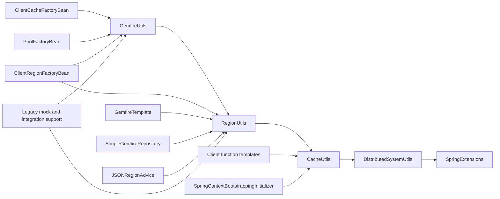

# Utility/root migration dependencies

Snapshot: 2026-10-20, integration branch `wayfinder/unified_driver`, after cache-loader migration. This is a source inventory and migration-boundary decision, not a runtime migration.

The next bounded change is to extract the two **string-only region-path functions** into a native-free `RegionPaths` utility and update all their repository callers. No SPI operation is required for that extraction. Runtime utility methods remain grouped with the native consumers that need them. [Implementation ticket](../../wayfinder-issues/07-region-path-utility-migration.md).

## Evidence and scope

[Reference index](../utility-root-references.tsv) records 118 qualified references, method references, static imports and calls resolved through those imports across 49 Java files. Of these, 53 records occur in 22 `src/main` files, 49 in 15 `src/test` files, and 16 in 12 `src/integrationTest` files. Counts include imports and references within utility implementations; they are not call counts. Java comments were excluded. Searches covered both project modules, excluding generated build directories. Overloads and the inheritance chain were checked against source; this is a textual inventory, not whole-program or external-client analysis.

Useful refresh queries from the repository root:

```sh
rg -n '\b(GemfireUtils|RegionUtils|CacheUtils|DistributedSystemUtils)(\.|::)' --glob '*.java' --glob '!**/build/**'
rg -n 'extends (GemfireUtils|RegionUtils|CacheUtils|DistributedSystemUtils)|import static .*\b(GemfireUtils|RegionUtils|CacheUtils|DistributedSystemUtils)\.' --glob '*.java' --glob '!**/build/**'
rg -n '\b(toRegionName|toRegionPath)\b' --glob '*.java' --glob '!**/build/**'
```

## Inheritance and consumers



Arrows between utilities mean inheritance; consumer arrows mean source references. `SpringExtensions` supplies ordinary Spring helpers and has no native GemFire imports. No subclasses of the four target utilities were found beyond this chain. Removing an inherited method from its declaring class also removes access through `GemfireUtils`, even if that source file is untouched.

### Native operation inventory

Paths below are relative to `spring-data-vmware-gemfire/src/main/java/org/springframework/data/gemfire/`.

| Declaring class / operation | Native dependency and behavior | Consumers and migration consequence |
| --- | --- | --- |
| `util/DistributedSystemUtils`: constants | `CacheServer.DEFAULT_PORT`; property names from `GemFireProperties` | Pool factory/parser, annotation defaults, pool configuration and factory-default adapter. Constant-only references do not require a runtime connection. Keep annotation defaults distinct from runtime engine discovery. |
| `configureDurableClient(Properties, id, timeout)` | String/property manipulation; mutates the supplied properties, using constants above | Called through `GemfireUtils` by `client/ClientCacheFactoryBean`. It can eventually be extracted as pure configuration logic; this does not remove that factory's native connection dependencies. |
| `isConnected`, `isNotConnected` | `DistributedSystem.isConnected()`; null means disconnected | `ClientCacheFactoryBean.resolveProperties`, `PoolFactoryBean.isClientCachePresent`, utility durability checks. Native connection state is not equivalent by definition to `!DriverConnection.isClosed()`. |
| `getDistributedSystem()` | `InternalDistributedSystem.getAnyInstance()` global lookup | `ClientCacheFactoryBean` passes it as a supplier, then merges existing native properties with configured properties. Migrating it requires an injected connection/creation owner and preserved native reuse behavior. |
| `getDistributedSystem(ClientCache)` | Obtains a native distributed-system object from the supplied cache | `CacheUtils.isDurable` and native code paths. Replace needed metadata operations, not the public API with an untyped native object. |
| `getLocator()` | `InternalLocator.getLocator()` global lookup and unchecked generic return | No main-source caller outside the declaration found; `src/test/.../fork/LocatorProcess` consumes it. Native process-test code must be accounted for before removing the helper. |
| `util/CacheUtils`: pool-name predicates | `Pool.getName()` plus string equality to `DEFAULT` | `ClientRegionFactoryBean.resolvePoolName` uses the String overload through inherited `GemfireUtils::isNotDefaultPool`; `PoolResolver`, function/CQ infrastructure consume the constant. String predicates can be separated independently; the native Pool overloads and pool resolution belong with pool migration. |
| `isDurable(ClientCache)` | Cache → distributed system → connected flag → durable-client property | `ClientCacheFactoryBean.isDurable` and `GemfireUtilsUnitTests`. Preserve this predicate's actual checks when its consumer moves. |
| `getClientCache`, `resolveGemFireCache` | `ClientCacheFactory.getAnyInstance()`; missing/closed cache becomes null | Pool factory, client function templates, bootstrap initializer, and test-support shutdown. `resolveGemFireCache` has no additional repository caller found. A new static driver lookup would violate the design. |
| `close()` / `close(ClientCache[, hook])` | Global lookup or supplied native cache; catches `Throwable`; hook runs in finally | Integration tests call the supplied-cache form through `GemfireUtils`. Constructor-injected ownership and typed failure behavior must replace these swallowing/global helpers during consumer migration. |
| `closeCache`, `closeClientCache` | Duplicate native global lookup/close; exceptions become false | No repository caller outside the declarations found. Do not reproduce redundant global APIs in the SPI. |
| `util/RegionUtils`: persistence checks | Native `DataPolicy.withPersistence()` and `ClientRegionShortcutWrapper` | `ClientRegionFactoryBean` configuration and tests. SPI enums already exist, but migrating this factory also requires its region creation/configuration dependencies. |
| `close(Region)`, `isCloseable` | Region close; owner `RegionService.isClosed()`; failures swallowed by close | `ClientRegionFactoryBean.destroy` and utility tests. Requires region shutdown/ownership semantics in the driver and migration of the factory's cleanup path. |
| `isClient`, `isServer` | Nonblank region pool name; `isServer` is its inverse for nonnull regions | `SimpleGemfireRepository.resolveRegionKeys` chooses `keySetOnServer` vs `keySet`; LOCAL client regions can have no pool. Do not substitute cache mode for the actual predicate. |
| `isLocal` | `region instanceof org.apache.geode.internal.cache.LocalRegion` | `GemfireTemplate` then checks native `Scope.LOCAL` and reflectively probes `hasServerProxy` to choose a query service. The predicate is an implementation-type check, not simply the LOCAL shortcut. Move query routing as a native driver operation when that surface migrates. |
| `toRegionName(Region)`, `toRegionPath(Region)` | Native `getName()` / `getFullPath()` | `serialization/json/JSONRegionAdvice` consumes these overloads. Its aspect pointcuts, PDX/JSON conversion and query result wrapper remain native, so the advice is not in the string-helper slice. |
| `toRegionName(String)`, `toRegionPath(String)` | Only native reference is the separator constant; otherwise string manipulation | Legacy mock helpers and tests across both modules. This is the selected independent extraction. |
| `GemfireUtils`: version/product | `CacheFactory.getVersion()`; failure becomes `unknown`; result cached in static `GEMFIRE_VERSION` | `AbstractResolvableCacheFactoryBean` diagnostics and `config/xml/ParsingUtils`. The driver already exposes `runtimeGemFireVersion`; migrated consumers must receive a driver, not another process-global snapshot or lookup. |
| `isClassAvailable` / feature predicates | Native CQ class-name presence, `GemfireFeature` / DOM element checks | `ParsingUtils` contains two guard methods, but no callers of those guards were found in main Java sources. Recheck before removal. No new SPI capability probe is justified; supported behavior is established by actual operations and typed failures. |
| `GemfireUtils.main` | Prints static product/version | Standalone entry point; must be accounted for when the version utility migrates. No repository caller found. |

### Transitive boundaries for later runtime slices

| Starting consumer | Additional boundary exposed by its public API or implementation | Driver operations needed when that group migrates |
| --- | --- | --- |
| `ClientCacheFactoryBean` | `AbstractResolvableCacheFactoryBean` → `AbstractConfigurableCacheFactoryBean` → `AbstractBasicCacheFactoryBean`; cache factory initialization/configuration, PDX, cache XML, transactions/resource settings, annotation/XML construction | Connection creation/reuse and metadata, plus configuration operations used by the factory; existing minimal `CacheConfiguration` cannot represent all of them. |
| `PoolFactoryBean` / `ClientRegionFactoryBean` | Pool resolution, default-pool handling, many native pool/region attributes and callback types, annotation/XML consumers | Pool handles/configuration and region creation/attributes/lifecycle. Changing a utility parameter alone cannot close this group. |
| `GemfireTemplate` | `GemfireAccessor`, `GemfireOperations`, `GemfireCallback`, native query interfaces and exception translation; consumers include DAO support, repository factory and JSON advice | Region bulk/conditional operations, query service/routing/results and exception categories. `GemfireCacheUtils` is a separate native exception translator, not one of the four inventoried classes. |
| `SimpleGemfireRepository` | Template/query operations, transaction checks, repository factory/query infrastructure | Local/server keys, bulk removal, query and transaction surfaces. Preserve server-vs-local behavior instead of guessing it from the mock. |
| `AbstractClientFunctionTemplate` | `GemfireOnServerFunctionTemplate`, `GemfireOnServersFunctionTemplate`, pool resolver and native function execution | Injected connection/pool and function execution handles; remove the fallback global cache lookup as its consumers move. |
| `SpringContextBootstrappingInitializer` | Native declarable/bootstrap callback and Spring context setup | A lifecycle boundary that can receive a driver-owned connection without a static manager. Scope needs separate implementation work. |
| `JSONRegionAdvice` | Native Region AOP pointcuts, `JSONFormatter`/PDX, `SelectResults` and `GemfireTemplate` | Region, PDX/JSON and query result operations. Its region-object overload calls are excluded from the pure string extraction. |

These are required surface areas, not finalized SPI signatures or promises that the official mock will simulate distributed behavior. Each new runtime method on an existing SPI interface must retain the default/typed-unsupported pattern. Global native state may remain inside a native driver; Spring consumers use injected handles.

## Selected slice and behavior evidence

Extract `RegionUtils.toRegionName(String)` and `toRegionPath(String)` to `org.springframework.data.gemfire.util.RegionPaths`, with the same method names and string signatures. Remove the two old string overloads and update every repository string caller in the same change. Keep the native Region overloads with their unmigrated consumers. No forwarding facade, new driver lookup, new SPI method, driver version change, native callback, or distributed mock behavior is needed.

The extraction closes 17 existing consumer files: two test-support main classes, six unit-test files across the modules, and nine Spring Data integration-test files. The reference index contains 18 path-reference files because `JSONRegionAdvice` uses only the native Region overloads and is deliberately excluded. The helper declaration, new utility, new focused tests and verification build configuration are additional implementation files.

The test-support changes only redirect string formatting calls. They do not migrate `spring-test-vmware-gemfire` off native GemFire and do not change its internal path normalization helpers.

A local Java probe copied the two current method bodies, replaced `Region.SEPARATOR` with its literal `/`, and executed them against cached Spring Core 7.0.8. Observed behavior:

| Input | `toRegionName` | `toRegionPath` |
| --- | --- | --- |
| null | null | `/null` |
| empty string | empty string | `/` |
| one space | one space | `/ ` |
| `a` | `a` | `/a` |
| `/a` | `a` | `//a` |
| `/a/b` | `b` | `//a/b` |
| `a/` | empty string | `/a/` |
| ` /a/b ` | `/b ` | `/ /a/b ` |

The whitespace result comes from finding the slash index in the trimmed string and slicing the original string. These helpers are not validators or idempotent normalizers. Preserve these behaviors during extraction; changing them is a separate behavior change. Probe source: `/private/tmp/RegionPathProbe.java`. This was a targeted behavior probe, not a full module test run.

## Validation for the inventory

Checked qualified calls, method references, static imports, utility inheritance, path overload argument types, known transitive consumers, and test-support build dependencies. No product source or Gradle configuration changed in this inventory ticket; no Gradle run was needed. The implementation ticket lists the compilation, focused behavioral and existing driver/cache checks required for its code change.
